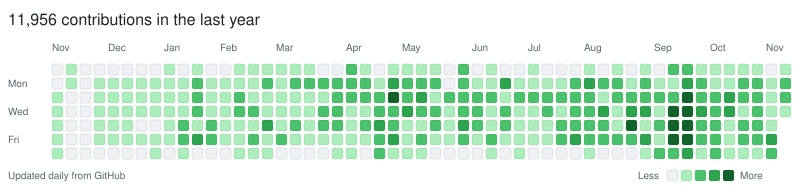

<picture>
  <source media="(prefers-color-scheme: dark)" srcset="assets/contributions-dark.svg">
  
</picture>

# Jonathan Benn

**Full-stack developer building AI tools, games, and native creative software.**

I'm based in Los Angeles. I build across the stack: product interfaces, APIs, databases, payments, native desktop apps, and real-time graphics. My projects range from a workspace for AI coding sessions to a jetpack game and live video production software.

[Portfolio](https://jonathanbenn.dev) · [LinkedIn](https://www.linkedin.com/in/jonathan-benn) · [Explore my repositories](https://github.com/BonJenn?tab=repositories)

## A consistent building habit

**11,900+ contributions · 7,600+ commit contributions · 4,200+ pull requests** in GitHub's trailing-year activity, with commits across **29 repositories**. My account also includes **30+ public, non-fork repositories** spanning developer tools, SaaS, automation, and consumer apps.

Activity snapshot: November 11, 2026. Figures come from GitHub's contribution API; repository count is account-wide.

## Featured projects

### [Blackcrab](https://github.com/BonJenn/blackcrab)

**A local desktop workspace for Claude Code.** Search and resume saved conversations, run up to six sessions side by side, inspect tool calls and diffs, and work with an integrated terminal and preview panel. Built around the local Claude CLI, with a React interface and a Rust backend handling processes, session files, and native desktop features.

**Skills:** TypeScript, React, Rust, Tauri, process orchestration, desktop UX.  
[Website](https://www.blackcrab.app/) · [Source & releases](https://github.com/BonJenn/blackcrab)

### [Jetpack Pals](https://github.com/BonJenn/jetpackpals)

**A jetpack-powered game set in Angel City, inspired by downtown Los Angeles.** An evolving Unity project combining flight, city exploration, races, and rooftop activities. The wider project includes a playable web entry point, an interactive city map, and a development blog.

**Skills:** C#, Unity, URP, gameplay systems, 3D environments, web integration.  
[Website](https://jetpackpals.com) · [Play](https://jetpackpals.com/play) · [Public showcase](https://github.com/BonJenn/jetpackpals)

Game source: [la-flight-game](https://github.com/BonJenn/la-flight-game) (private repository).

### [Clonebase](https://github.com/BonJenn/clonebase)

**An AI app builder and marketplace for reusable apps.** Describe an idea, refine it through a conversational builder, and publish or clone an app. The platform brings together live previews, tenant data, authentication, file storage, payments, and versioned templates.

**Skills:** TypeScript, Next.js, React, Supabase/Postgres, AI APIs, Stripe Connect, multi-tenant architecture.  
[App](https://clonebase.vercel.app) · [Source](https://github.com/BonJenn/clonebase)

### [Vantaview](https://github.com/BonJenn/vantaview)

**Native macOS software for live video production.** Brings camera switching, preview/program outputs, real-time effects, overlays, and stage visuals into one workspace. Combines a SwiftUI interface with Metal rendering, alongside a web platform for accounts and subscriptions.

**Skills:** Swift, SwiftUI, Metal, real-time video, GPU rendering, subscription infrastructure.  
[Project overview](https://github.com/BonJenn/vantaview)

## My toolkit

| Area | Technologies |
| --- | --- |
| Web & APIs | TypeScript, JavaScript, React, Next.js, Node.js, Express |
| Native & desktop | Swift, SwiftUI, Metal, Rust, Tauri |
| Games & graphics | C#, Unity, URP, real-time rendering |
| Data & infrastructure | PostgreSQL, Supabase, MongoDB, Firebase, AWS |
| Product systems | AI integrations, Stripe, authentication, GitHub Actions |

## More things I've built

- [YT Factory](https://github.com/BonJenn/yt-factory) — automated video production, from scripting and narration to editing and YouTube publishing.
- [Bitcoin Brainiac](https://github.com/BonJenn/bitcoinbrainiac_v2) — an AI-powered Bitcoin newsletter built with TypeScript, React, Next.js, and Express.

Explore the projects above, browse the code, or [connect on LinkedIn](https://www.linkedin.com/in/jonathan-benn).
